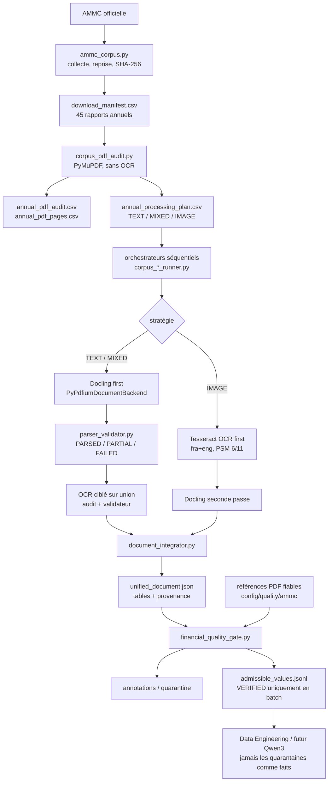

# Architecture Parsing & OCR AMMC

## Vue d'ensemble

## Composants réels

| Composant | Point d'entrée | Entrées | Sorties | Dépendances et erreurs |
|---|---|---|---|---|
| Collecte du corpus | `collectors/ammc_corpus.py` — `main`, `discover_reports`, `download_with_resume`, `download_annual_reports` | pages AMMC, `config/data/ammc_corpus.json` | inventaire, manifeste, PDF sous `data/raw/ammc/` | `httpx`, BeautifulSoup ; retries, reprise HTTP, contrôle PDF, SHA-256, déduplication |
| Audit léger | `processing/corpus_pdf_audit.py` — `run_audit`, `audit_pdf` | manifeste et PDF locaux | quatre artefacts d'audit sous `data/processed/ammc/corpus_audit/` | PyMuPDF seulement ; isole les erreurs par PDF et poursuit |
| Plan de traitement | `build_processing_plan` | lignes d'audit | stratégie, priorité, lots, workload | un document à la fois ; formule `pages + 4 × pages OCR` |
| Parseur Docling | `parsers/pdf_parser.py` — `AMMCPDFParser.parse` | PDF valide | `document.md`, `document.json`, `tables/*.csv`, `metadata.json` | Docling + `PyPdfiumDocumentBackend`; `do_ocr=False`, structure de tables activée |
| Validation structurelle | `parsers/parser_validator.py` — `ParserValidator.validate` | exports Docling et tables | rapport de validation, pages/tableaux OCR requis, hashes | contrôle fichiers, dimensions, cellules, pages, en-têtes, libellés et images financières |
| OCR générique | `parsers/ocr_recovery.py` — `recover_document` | PDF, pages ou régions, métadonnées Docling optionnelles | CSV OCR, coordonnées JSON, `ocr_metadata.json` | CLI Tesseract ; erreur explicite si binaire absent ; cache par source/config/sélection |
| Intégration | `parsers/document_integrator.py` — `integrate` | métadonnées Docling et/ou OCR | `data/integrated/ammc/*/unified_document.json` | vérifie identité PDF et hashes ; déduplique les OCR identiques ; ne modifie pas les sources |
| Quality Gate | `parsers/financial_quality_gate.py` — `evaluate_quality`, `load_admissible_values` | document intégré + règles | annotations, quarantaine, admissibles, rapport qualité | contrôles numériques/contextuels ; empreinte règles + sources ; contrat downstream |
| Références fiables | `processing/financial_reference_validation.py` — `run_reference_validation` | configuration de références, PDF original, document intégré | concordance, valeurs vérifiées, file de revue | contrôle identité, exercice, montant, signe, unité/échelle, périmètre, page/table et preuves |
| Priorisation/revue | `processing/financial_validation_extension.py` | registre d'indicateurs et candidats | file priorisée, contrôles déterministes, dossiers de revue | un score ne produit jamais `VERIFIED` |
| Worker documentaire | `processing/corpus_pipeline_pilot.py` — `run_one` | une sélection issue du plan | `pilot_result.json` et artefacts de chaque étape | empreinte complète, mesure RSS, cache validé par hashes |
| Lots | `corpus_batch_runner.py`, `corpus_extension_runner.py`, `corpus_extension_14_runner.py` à `17_runner.py` | sélections autorisées | rapports de lots | sous-processus isolé, séquentiel, reprise, arrêt document par document |
| Rapports | `data_04_12_report.py` à `data_04_17_report.py`, `financial_multisector_report.py` | résultats techniques et références | couverture, exports, rapports qualité | contrôle non-régression et absence de fuite downstream |

Les chemins Python du tableau sont relatifs à `src/moroccan_markets_ai/data/`.

## Classification de l'audit

La configuration réelle est `AuditConfig` :

- texte présent : au moins 40 caractères sur la page ;
- image significative : au moins 15 % de la surface de page ;
- page `MIXED` si les deux conditions sont vraies, `TEXT` ou `IMAGE` si une seule l'est, sinon `UNKNOWN` ;
- document `IMAGE` si au moins 80 % des pages le sont ;
- document `TEXT` si au moins 80 % des pages portent du texte et si au plus 20 % des pages sont candidates OCR ;
- tout document ayant du texte ou des images sans satisfaire ces ratios devient `MIXED` ; sinon `UNKNOWN`.

Une page `IMAGE` est candidate OCR. Une page `UNKNOWN` sans texte mais avec image l'est aussi. Une page `MIXED` l'est si elle contient moins de 200 caractères. L'audit ne suppose jamais qu'une image est un tableau financier.

## Pourquoi ces choix techniques

PyMuPDF réalise l'audit sans charger les modèles Docling et fournit texte, images, surfaces et pages à faible coût. Docling est utilisé pour la structure documentaire et tabulaire ; `PyPdfiumDocumentBackend` a remplacé le backend qui provoquait un `SIGSEGV` sur Stroc. Tesseract reste séparé de Docling pour cibler seulement les pages justifiées, comparer PSM 6 et 11 et conserver les coordonnées. Les workers sont strictement séquentiels et isolés : sur le Mac Intel 8 Go observé, le pic maximal du corpus a été 3 512,6 MiB, mais cette mesure RSS n'est pas une garantie universelle de mémoire disponible.

## Stratégies exécutées

- `DOCLING_FIRST_TARGETED_OCR` : les 31 `TEXT` et 12 `MIXED`. Docling produit la base ; l'OCR porte sur l'union des pages proposées par l'audit et le validateur.
- `OCR_FIRST` : les 2 `IMAGE` Dari Couspate 2024/2025. L'OCR précède Docling. L'intégration conserve les tables OCR quand Docling ne produit aucune table non vide.

La stratégie fait partie de l'empreinte du pipeline. Un changement de backend, configuration Docling, OCR, règles qualité, source ou sélection de pages invalide le cache concerné.
